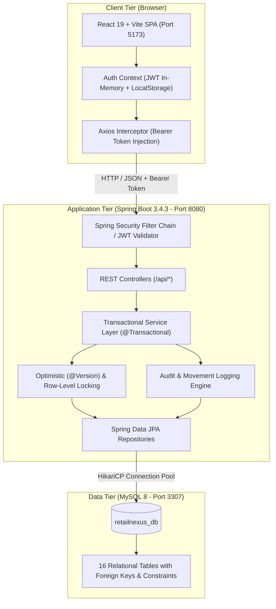
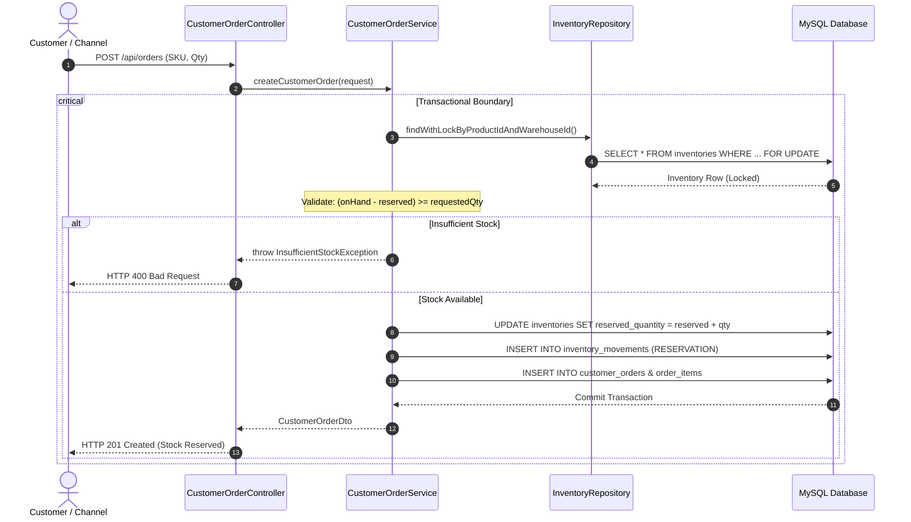
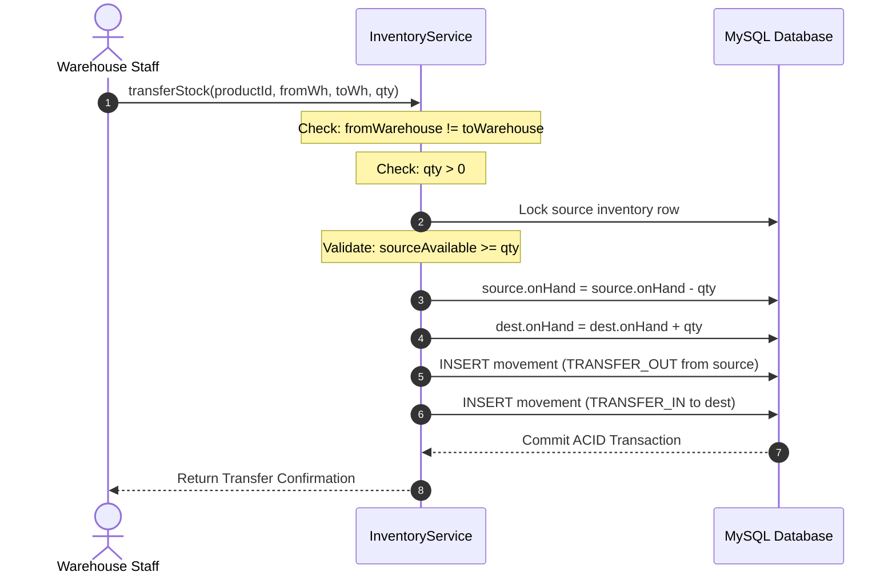

# System Architecture & Technical Design — RetailNexus

## 1. High-Level Architecture Overview
RetailNexus follows an enterprise 3-tier architecture with clean separation of concerns:
- **Presentation Tier:** React 19 Single Page Application built with Vite, Tailwind CSS, Lucide Icons, and Recharts.
- **Application Tier:** Java 24 / Spring Boot 3.4.3 REST API with Spring Security (stateless JWT), Spring Data JPA, Hibernate ORM, and Bean Validation.
- **Data Tier:** MySQL 8 Relational Database on dedicated port `3307` (`retailnexus_db`) managed via Flyway schema migrations.

---

## 2. Inventory Concurrency & Locking Architecture

To guarantee zero negative stock balances and prevent overselling during concurrent transactions, RetailNexus combines:
1. **Optimistic Locking (`@Version`):**
   - The `inventories` table contains a `version BIGINT NOT NULL DEFAULT 0` column.
   - Any concurrent update detecting an outdated version throws `OptimisticLockingFailureException` and automatically triggers a safe retry or friendly rejection.
2. **Pessimistic Row Locking (`PESSIMISTIC_WRITE`):**
   - For high-contention critical operations such as customer order reservation, `InventoryRepository.findWithLockByProductIdAndWarehouseId` executes `SELECT ... FOR UPDATE` ensuring serialized execution at the database level.
3. **Database Check Constraints:**
   - Database table constraints enforce `CHECK (on_hand_quantity >= 0)` and `CHECK (reserved_quantity >= 0)`.

---

## 3. Atomic Inter-Warehouse Transfer Workflow

Inter-warehouse transfers operate across two warehouse nodes within a single atomic database transaction. If any step fails, the entire transaction rolls back cleanly.

---

## 4. Security & Role-Based Access Architecture

| Role Identifier | Assigned UI Navigation Scopes | Permitted Backend REST Endpoints |
|-----------------|-------------------------------|----------------------------------|
| `ROLE_ADMIN` | Full access across all 13 modules | Unrestricted (`hasRole('ADMIN')`) |
| `ROLE_INVENTORY_MANAGER` | Overview, Inventory, Operations, Insights, Agile | Products, Warehouses, Transfers, Suppliers, POs |
| `ROLE_WAREHOUSE_STAFF` | Stock adjustments, Transfers, Orders, Inbound PO Receiving | `/api/inventory/*`, `/api/orders/*/status`, `/api/purchase-orders/*/receive` |
| `ROLE_VIEWER` | Read-only dashboards and tables | `GET` requests only across all entities |
