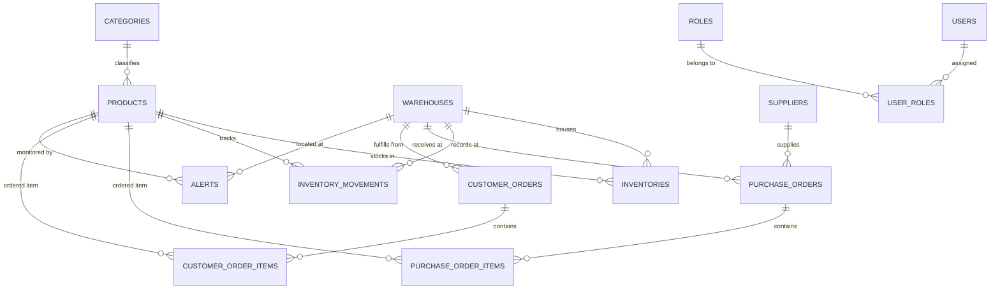

# Database Schema & Entity Relational Design — RetailNexus

## 1. Database Overview
- **Database Engine:** MySQL 8.0 Community Server
- **Database Name:** `retailnexus_db`
- **Port:** `3307`
- **Charset:** `utf8mb4`
- **Collation:** `utf8mb4_unicode_ci`
- **Migration Strategy:** Flyway (`V1__init_schema.sql`, `V2__seed_data.sql`)

---

## 2. Table Specifications & Relationships

### Core Security & RBAC Tables
1. **`roles`**: Primary security authority records (`ROLE_ADMIN`, `ROLE_INVENTORY_MANAGER`, `ROLE_WAREHOUSE_STAFF`, `ROLE_VIEWER`).
2. **`users`**: System user accounts with BCrypt-hashed passwords, full name, email, phone, and active status flag.
3. **`user_roles`**: Many-to-many join table mapping `user_id` to `role_id`.

### Product & Facility Catalog Tables
4. **`categories`**: Product taxonomy hierarchy (`name`, `code`, `description`).
5. **`products`**: 26 seeded SKUs with `name`, `sku` (UNIQUE), `barcode`, `category_id` (FK), `cost_price`, `selling_price`, `reorder_point`, `safety_stock`, `active`.
6. **`warehouses`**: Regional depots (Mumbai Central, Delhi North Hub, Bengaluru South Depot) with `code` (UNIQUE), `name`, `address`, `city`, `capacity`, `manager_name`, `contact_phone`, `contact_email`, `active`.

### Inventory Engine Tables
7. **`inventories`**: Composite primary key (`product_id`, `warehouse_id`) tracking:
   - `on_hand_quantity INT NOT NULL DEFAULT 0`
   - `reserved_quantity INT NOT NULL DEFAULT 0`
   - `version BIGINT NOT NULL DEFAULT 0` (Optimistic locking)
   - `CHECK (on_hand_quantity >= 0)`
   - `CHECK (reserved_quantity >= 0)`
8. **`inventory_movements`**: Immutable audit log of every stock movement:
   - `movement_type` (`PURCHASE_RECEIPT`, `DISPATCH`, `TRANSFER_IN`, `TRANSFER_OUT`, `ADJUSTMENT_ADD`, `ADJUSTMENT_SUBTRACT`, `RESERVATION`, `RELEASE`)
   - `quantity`, `reference_number`, `reason`, `notes`, `created_by`, `created_at`.

### Procurement & Vendor Tables
9. **`suppliers`**: Vendor partners with `code`, `name`, `contact_person`, `email`, `phone`, `city`, `gstin`, `active`.
10. **`purchase_orders`**: Procurement orders (`po_number`, `supplier_id`, `destination_warehouse_id`, `order_date`, `expected_delivery_date`, `status`, `total_amount`, `notes`).
11. **`purchase_order_items`**: Line items per PO (`purchase_order_id`, `product_id`, `quantity_ordered`, `quantity_received`, `unit_cost`, `total_price`).

### Customer Order Fulfillment Tables
12. **`customer_orders`**: Customer sales orders (`order_number`, `customer_name`, `customer_email`, `customer_phone`, `shipping_address`, `warehouse_id`, `order_date`, `status`, `total_amount`, `notes`).
13. **`customer_order_items`**: Line items per customer order (`customer_order_id`, `product_id`, `quantity`, `unit_price`, `total_price`).

### Alerts, Auditing & Capstone Project Tables
14. **`alerts`**: Low-stock and operational warning triggers (`alert_type`, `severity`, `title`, `message`, `product_id`, `warehouse_id`, `acknowledged`, `acknowledged_by`, `acknowledged_at`).
15. **`audit_logs`**: Administrative audit trail recording entity lifecycle events.
16. **`agile_sprints`**: The 15 planned Scrum sprints tracking `sprint_number`, `name`, `goal`, `status`, `story_points_planned`, `story_points_completed`, `start_date`, `end_date`.

---

## 3. Entity-Relationship Diagram (Mermaid)

